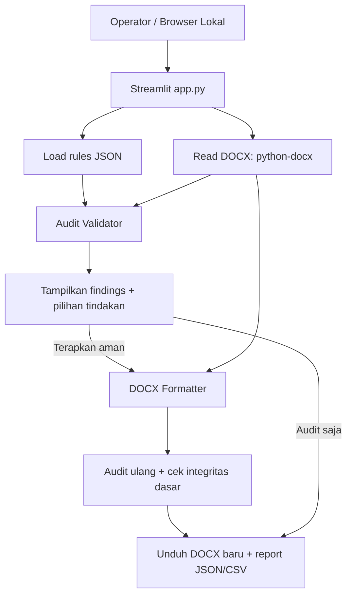

# Arsitektur — satu aplikasi Python, tanpa overengineering

## 1. Diagram alur



**Tanpa agent AI pada v0.1.** Codex dipakai sebagai **alat pengembang kode**, bukan dependency runtime aplikasi.

## 2. Struktur direktori target

```text
ppki-academic-formatter/
├── AGENTS.md
├── app.py                    # UI Streamlit, hanya orkestrasi sederhana
├── core/
│   ├── rules.py              # baca JSON, filter applicability, registry handler
│   ├── audit.py              # pemeriksaan -> findings
│   ├── formatter.py          # apply perubahan aman di DOCX
│   └── reports.py            # report JSON/CSV + info traceability
├── rules/
│   ├── ppki_rules_all.json
│   └── ppki_rules_mvp25.json
├── docs/
│   ├── PRD.md
│   ├── ERD.md
│   ├── ARCHITECTURE.md
│   └── TASKS.md
├── tests/                    # fixtures DOCX kecil dan unit tests
├── requirements.txt
├── .gitignore
└── README.md
```

Buat file ini **seiring pengerjaan task**, jangan generate boilerplate kosong untuk setiap kemungkinan fitur.

## 3. Kontrak pemrosesan

**Input:** bytes DOCX, pilihan `degree` (`S1` / `S2` / `S3`), snapshot rules.  
**Output:** daftar findings, DOCX baru (bila pengguna menerapkan), report JSON/CSV.  
**State:** cukup `st.session_state` dan file sementara lokal selama proses berjalan; tidak butuh DB atau queue.

Contoh status finding: `pass`, `fail`, `fixed`, `needs_review`, `not_supported`, `error`.

**Langkah:**
1. Pastikan ekstensi `.docx`, ukuran wajar (default 20 MB), dan zip package bisa dibaca; beri error informatif saat gagal.
2. Hitung SHA-256 dataset JSON yang digunakan; simpan untuk keterlacakan.
3. Baca aturan lalu filter applicability eksplisit. Minimal: `Semua` berlaku untuk S1/S2/S3; `Skripsi` hanya S1; `Tesis` hanya S2; `Disertasi` hanya S3; `Tesis/Disertasi` untuk S2/S3. Label lain seperti `Skripsi FKH`, `Semua terkait` memiliki konteks khusus: **jangan anggap sama dengan `Semua`** tanpa mapping pedoman yang disetujui.
4. Tentukan validator dari **`validation_key` yang secara eksplisit didaftarkan di kode**. Tanpa handler -> `not_supported`.
5. Audit dulu. Tampilkan perubahan yang mungkin dan lokasi temuan.
6. Terapkan hanya action aman dengan handler yang tersedia, sesuai `fix_mode`. `Confirm` wajib persetujuan eksplisit. `Manual` tidak diubah otomatis.
7. Simpan DOCX hasil dalam bytes/file baru. Audit ulang dan cek integritas dasar.
8. Unduh output dan laporan. Untuk pekerjaan nyata, periksa tampilannya di Microsoft Word.

## 4. Aturan penting tentang Word

- Format harus mengubah properti XML/Word **in-place pada salinan**, bukan merekonstruksi seluruh dokumen dari teks.
- **Jangan set `paragraph.text`** untuk format, karena bisa menghilangkan `runs` dan konten kompleks.
- Font utama hanya untuk paragraf **teks isi** yang dikenali jelas; skip paragraf field/hyperlink/kompleks yang belum didukung.
- Untuk section, audit setiap section. Jika perbaikan margin satu section mungkin mengubah tata letak khusus, sediakan alasan skip.
- Jangan memanipulasi isi tabel, gambar, equations, footnotes, daftar pustaka dan cross-reference pada tahap awal.
- Indentasi first line 1 cm untuk body yang aman saja; paragraf khusus harus bisa dikecualikan.
- Jika terjadi error validasi, hasil tidak boleh diklaim sukses meskipun berkas DOCX terbentuk.

## 5. Rules PPKI yang diprioritaskan

`PPKI-LAY-003`, `PPKI-LAY-005`, `PPKI-LAY-008`, `PPKI-LAY-009`, `PPKI-LAY-010`, `PPKI-LAY-011`, `PPKI-LAY-017`, `PPKI-LAY-018`, `PPKI-LAY-019`.

Semua nilai harus diturunkan dari **mapping eksplisit yang mengikuti data PPKI**: A4, Times New Roman 12 pt, kiri 4 cm, kanan 3 cm, atas 3 cm, bawah 3 cm, spasi 1,0, indent 1 cm, justified. Jangan mengganti dengan nilai kebiasaan kampus lain. Tulis tes untuk setiap angka/format.

## 6. AI API — tidak dipakai sampai MVP manual lulus

Jika di kemudian hari AI dibutuhkan, buat **satu** fungsi opsional `analyze_ambiguous_structure(text_excerpt) -> suggestions` yang hanya menerima potongan teks yang disetujui operator, menghasilkan JSON terstruktur, dan **tidak** mengubah DOCX secara langsung. Jangan tambah framework agent. Jangan masukkan AI pada task P0.
