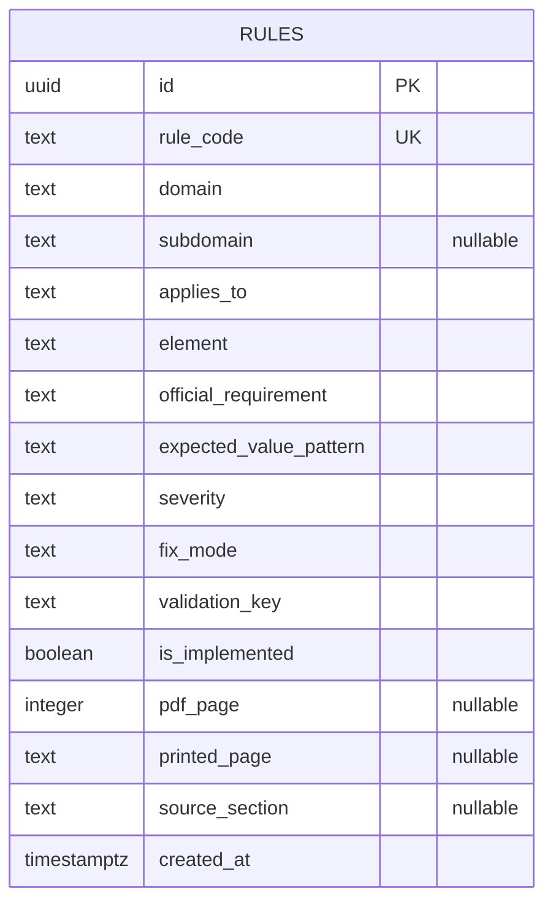
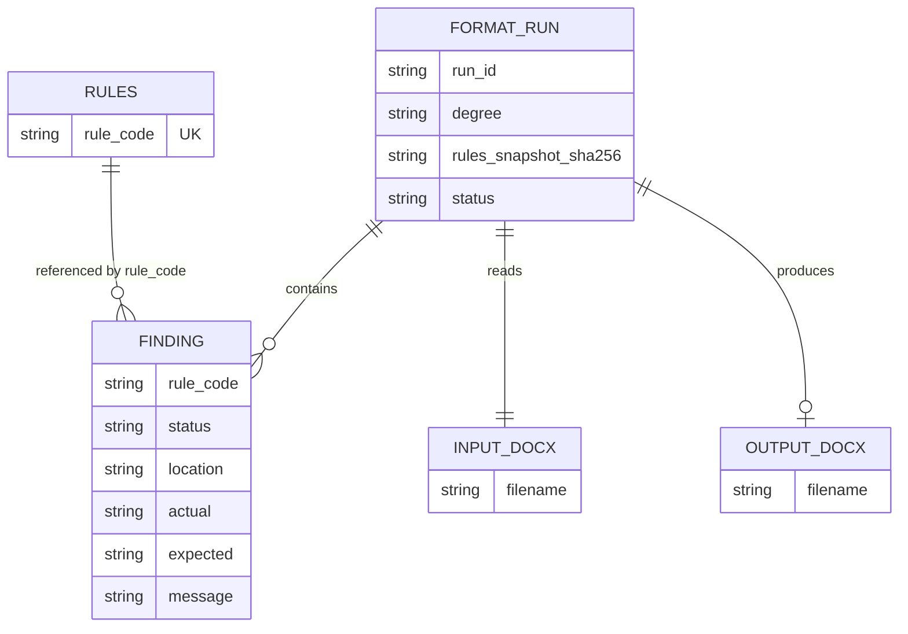

# ERD — PPKI Academic Formatter (MVP)

## 1. Database fisik yang ada: **satu tabel Supabase**

Kita **tidak membuat tabel baru** untuk v0.1. Satu-satunya tabel permanen yang sudah dimiliki adalah `public.rules` (317 record dari ekspor). Karena hanya satu tabel, tidak ada relasi foreign key yang perlu dibuat.



### Kolom dan pemakaiannya
| Field | Dipakai untuk |
|---|---|
| `id` | Primary key internal Supabase; jangan ditampilkan sebagai nama aturan. |
| `rule_code` | Identitas stabil aturan di UI, laporan, dan log. **Unique**. |
| `domain`, `subdomain` | Pengelompokan laporan, contoh LAY dan HDG. |
| `applies_to` | Filter jenjang atau kondisi; nilainya masih teks, tidak ternormalisasi. |
| `element` | Nama aspek dokumen yang dicek. |
| `official_requirement` | Bunyi aturan yang berasal dari pedoman. |
| `expected_value_pattern` | Petunjuk nilai yang diharapkan; **bukan ekspresi executable**. |
| `severity` | `Error`, `Warning`, `Info`. |
| `fix_mode` | `Auto`, `Confirm`, `Manual`. |
| `validation_key` | Kunci pemetaan implementasi validator/formatter. |
| `is_implemented` | Status metadata dari dataset; perlu verifikasi implementasi kode. |
| `pdf_page`, `printed_page`, `source_section` | Lokasi aturan pada pedoman sumber. |
| `created_at` | Waktu pembuatan record. |

**Constraint yang sudah ada:** `rules_pkey(id)` dan `rules_rule_code_key(rule_code)`. Tidak ada `institution_id` / `guideline_id`; MVP menggunakan **satu himpunan aturan PPKI** sesuai ekspor yang tersedia, bukan otomatis mendukung semua kampus.

## 2. Model data lokal **tanpa tabel database tambahan**

Setiap pemrosesan membuat file sementara/hasil dan `report.json`. Diagram berikut adalah **model logis di memori / file JSON**, **bukan** instruksi membuat tabel SQL:



**Catatan diagram:** `RULES` di bagian kedua hanya menampilkan key logis untuk membaca relasinya; bukan tabel baru maupun duplikasi skema fisik di bagian pertama.

### Contoh `report.json` (kontrak minimal)
```json
{
  "run_id": "contoh-run-001",
  "degree": "S1",
  "rules_snapshot_sha256": "<sha256-file-rules>",
  "input_filename": "contoh-skripsi.docx",
  "output_filename": "contoh-skripsi_formatted.docx",
  "findings": [
    {
      "rule_code": "PPKI-LAY-008",
      "status": "fixed",
      "location": "section:1",
      "actual": "3 cm",
      "expected": "4 cm",
      "message": "Margin kiri diperbaiki sesuai aturan PPKI"
    }
  ]
}
```

## 3. Aturan migrasi data — **jangan migrasi dulu**

- Tidak perlu menambahkan `documents`, `users`, `jobs`, `findings` sebagai tabel.
- Jangan meminta kredensial Supabase untuk memulai. Codex membaca **file JSON lokal** di `rules/`.
- Saat rules berubah di Supabase, operator mengekspor ulang dan mengganti snapshot lokal melalui proses sadar/terkendali.
- Jika suatu saat benar-benar perlu multi-kampus atau histori online, **buat PRD baru** sebelum memutuskan skema tambahan.
